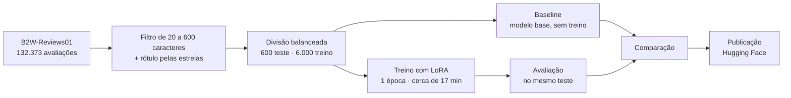

<div align="center">

# 🧠 Fine-tuning de LLM para Polaridade de Avaliações em Português

**Um LLM de 0,5B de parâmetros ajustado com LoRA para ler avaliações de clientes e classificá-las como negativas, neutras ou positivas.**

[](https://www.python.org/)
[](https://pytorch.org/)
[](https://huggingface.co/nicollesantana/qwen2.5-0.5b-polaridade-ptbr-lora)
[](#-métricas-do-modelo)
[](#-métricas-do-modelo)
[](#-licenças-e-créditos)

[Modelo publicado](https://huggingface.co/nicollesantana/qwen2.5-0.5b-polaridade-ptbr-lora) · [Como usar](#-como-usar) · [Métricas](#-métricas-do-modelo) · [Exemplos](#-exemplos-de-uso)

</div>

---

## Sumário

- [Sobre o projeto](#-sobre-o-projeto)
- [Características principais](#-características-principais)
- [Como usar](#-como-usar)
- [Como funciona](#-como-funciona)
- [Estrutura do projeto](#-estrutura-do-projeto)
- [Tecnologias utilizadas](#-tecnologias-utilizadas)
- [Métricas do modelo](#-métricas-do-modelo)
- [Exemplos de uso](#-exemplos-de-uso)
- [Notas importantes](#-notas-importantes)
- [Limitações](#-limitações)
- [Licenças e créditos](#-licenças-e-créditos)
- [Autora](#-autora)

---

## Sobre o projeto

Este projeto mostra o ciclo completo de ajustar um LLM para uma tarefa específica: **medir o modelo base, treinar, medir de novo no mesmo teste, comparar e publicar**.

A pergunta que ele responde é simples: um modelo pequeno, treinado por poucos minutos com poucos exemplos, consegue aprender a distinguir avaliações negativas, neutras e positivas, inclusive a classe do meio, que o modelo base nunca previa?

### Resultado em uma olhada

| Métrica | Modelo base | Modelo ajustado | Ganho |
|---|:---:|:---:|:---:|
| **Acurácia** | 61,5% | **76,5%** | +15,0 pontos percentuais |
| **F1 macro** | 0,49 | **0,76** | +0,27 |
| **F1 da classe neutro** | 0,00 | **0,66** | o modelo base nunca previa "neutro" |

> Avaliação em 600 avaliações de teste (200 por classe), separadas antes do treino.

---

## Características principais

- ✅ Ajuste fino com **LoRA** de um LLM de 0,5 bilhão de parâmetros, treinando só 8,8 milhões (1,75% do modelo)
- ✅ Classificação em **três classes**: negativo, neutro e positivo
- ✅ **Avaliação comparativa** entre o modelo base (zero-shot) e o modelo ajustado, no mesmo teste fixo
- ✅ Teste **separado antes do treino**, balanceado e sem avaliações em comum com o treino
- ✅ Saída de **uma palavra**, fácil de usar em outros sistemas
- ✅ Adapter leve (cerca de 35 MB), **publicado no Hugging Face**
- ✅ Treino em cerca de **17 minutos** numa GPU gratuita do Kaggle
- ✅ Reprodutível: semente fixa (42), `requirements.txt` e notebook com todas as saídas

---

## Como usar

### Usar o modelo publicado

O adapter é carregado em cima do modelo base, que é baixado automaticamente do Hugging Face.

**1. Instale as dependências**

```bash
pip install transformers peft torch
```

**2. Rode o código**

```python
import torch
from peft import PeftModel
from transformers import AutoModelForCausalLM, AutoTokenizer

BASE = "Qwen/Qwen2.5-0.5B-Instruct"
ADAPTER = "nicollesantana/qwen2.5-0.5b-polaridade-ptbr-lora"

tok = AutoTokenizer.from_pretrained(BASE)
model = AutoModelForCausalLM.from_pretrained(BASE, dtype=torch.float32)
model = PeftModel.from_pretrained(model, ADAPTER)
model.eval()

SYSTEM = ("Você classifica a polaridade de avaliações de clientes em português. "
          "Responda apenas com uma palavra: positivo, neutro ou negativo.")

def classificar(texto):
    msgs = [{"role": "system", "content": SYSTEM}, {"role": "user", "content": texto}]
    prompt = tok.apply_chat_template(msgs, tokenize=False, add_generation_prompt=True)
    enc = tok(prompt, return_tensors="pt", add_special_tokens=False)
    with torch.no_grad():
        out = model.generate(**enc, max_new_tokens=4, do_sample=False)
    return tok.decode(out[0, enc.input_ids.shape[1]:], skip_special_tokens=True).strip()

print(classificar("Produto ok, nada demais."))  # neutro
```

> [!IMPORTANT]
> O prompt acima é o mesmo usado no treino. Mudar a instrução pode piorar os resultados.

### Reproduzir o treino

Precisa de uma GPU. O treino levou cerca de 17 minutos em GPU gratuita do Kaggle.

1. Abra um notebook no Kaggle (ou no Colab) com **GPU** e **internet** ligadas.
2. Instale as dependências: `pip install -r requirements.txt`.
3. Copie as células do `finetune_polaridade_ptbr.py`, uma por vez, e rode em ordem. Ou abra o `finetune_llm_polaridade_ptbr.ipynb`, que é a execução completa.
4. No Kaggle, se o `peft` reclamar da versão do `torchao`, rode `pip uninstall -y torchao` antes do treino.

---

## Como funciona



| Etapa | O que acontece |
|---|---|
| **1. Dados** | Corpus [B2W-Reviews01](https://github.com/americanas-tech/b2w-reviews01), com 132.373 avaliações de produtos da Americanas.com. Ficam as avaliações de 20 a 600 caracteres, e a nota em estrelas vira o rótulo: 1 e 2 = negativo, 3 = neutro, 4 e 5 = positivo |
| **2. Divisão** | 600 avaliações para teste e 6.000 para treino, balanceadas por classe e sem avaliações em comum (semente 42) |
| **3. Baseline** | O modelo base é avaliado no teste, sem treino, com o mesmo prompt |
| **4. Treino** | LoRA (r = 16, alpha = 32) nas camadas lineares da atenção e do MLP, 1 época, perda calculada só na resposta |
| **5. Avaliação** | O modelo ajustado é avaliado no mesmo teste, e as métricas são salvas em `resultados.json` |

---

## Estrutura do projeto

```
finetune-llm-polaridade-ptbr/
│
├── README.md                              # Este arquivo
├── finetune_llm_polaridade_ptbr.ipynb     # Execução completa no Kaggle, com as saídas
├── finetune_polaridade_ptbr.py            # Script limpo, dividido em células
├── resultados.json                        # Métricas do modelo base e do ajustado
├── requirements.txt                       # Dependências do projeto
└── .gitignore
```

---

## Tecnologias utilizadas

| Tecnologia | Para que serve no projeto |
|---|---|
| **Python** | Linguagem de todo o projeto |
| **Qwen2.5-0.5B-Instruct** | Modelo de linguagem base que foi ajustado |
| **PyTorch** | Execução do modelo e do treino na GPU |
| **Hugging Face Transformers** (5.23.0) | Carregamento do modelo e do tokenizer, prompt de chat e `Trainer` para o treino |
| **PEFT** (0.21.3) | LoRA, que treina só 1,75% dos parâmetros do modelo |
| **Hugging Face Datasets** (5.2.0) | Construção do conjunto de treino |
| **Accelerate** | Usado pelo `Trainer` para gerenciar o treino na GPU |
| **Hugging Face Hub** | Download do CSV dos dados e publicação do adapter |
| **scikit-learn** | Métricas de avaliação: acurácia, F1, relatório por classe e matriz de confusão |
| **pandas** e **NumPy** | Filtragem, rotulagem e sorteio das amostras |
| **Kaggle Notebooks** | Ambiente de execução, com GPU gratuita |
| **Git e GitHub** | Versionamento e publicação do código |

---

## Métricas do modelo

Avaliação em 600 avaliações de teste (200 por classe), com decodificação gulosa. Uma resposta que não começa com uma das três classes conta como inválida.

### Geral

| Modelo | Acurácia | F1 macro | Respostas inválidas |
|---|:---:|:---:|:---:|
| Base (zero-shot) | 0,615 | 0,492 | 1 |
| **Ajustado (LoRA)** | **0,765** | **0,764** | **0** |

### Por classe

| Classe | Modelo | Precisão | Recall | F1 |
|---|---|:---:|:---:|:---:|
| negativo | Base | 0,64 | 0,96 | 0,77 |
| negativo | **Ajustado** | 0,84 | 0,90 | **0,86** |
| neutro | Base | 0,00 | 0,00 | 0,00 |
| neutro | **Ajustado** | 0,66 | 0,66 | **0,66** |
| positivo | Base | 0,59 | 0,88 | 0,71 |
| positivo | **Ajustado** | 0,79 | 0,74 | **0,77** |

### Matriz de confusão do modelo ajustado

Linhas: classe verdadeira. Colunas: classe prevista.

| | negativo | neutro | positivo |
|---|:---:|:---:|:---:|
| **negativo** | **179** | 20 | 1 |
| **neutro** | 31 | **131** | 38 |
| **positivo** | 4 | 47 | **149** |

O modelo base não previu "neutro" em nenhuma das 600 avaliações. Depois do ajuste, a maior parte dos erros acontece entre classes vizinhas (neutro com positivo e neutro com negativo).

---

## Exemplos de uso

Frases testadas no modelo publicado, com a resposta que ele deu:

| Frase | Classe prevista |
|---|:---:|
| ✅ "Chegou antes do prazo, adorei! Produto excelente, recomendo muito." | **positivo** |
| ❌ "Produto chegou quebrado e o vendedor não respondeu. Péssimo." | **negativo** |
| ➖ "Produto ok, nada demais." | **neutro** |
| ➖ "Chegou antes do prazo, produto igual ao anunciado." | **neutro** |

> [!NOTE]
> A última frase só descreve fatos, sem elogio forte, e o modelo a classificou como neutra, o que é uma leitura razoável. Quatro exemplos escolhidos à mão servem para mostrar o uso e não medem desempenho: a medida oficial é a das 600 avaliações de teste.

---

## Notas importantes

- O modelo foi treinado com avaliações de **20 a 600 caracteres**. Textos muito longos podem se comportar de forma diferente.
- O prompt do `classificar` é o mesmo do treino. Trocar a instrução pode piorar os resultados.
- Os dados são avaliações de **produtos de e-commerce coletadas entre janeiro e maio de 2018**. O modelo não foi avaliado em outros domínios, como avaliações de restaurantes ou de entregas.
- Os rótulos vêm da nota em estrelas, e a diferença entre notas vizinhas é subjetiva, principalmente no neutro. Isso limita o desempenho.
- Os dados são baixados de uma cópia em CSV do B2W-Reviews01 publicada no Hugging Face, porque o dataset original usa um script de carregamento que a biblioteca `datasets` atual não executa.
- O adapter precisa do modelo base para funcionar, e o código acima o baixa sozinho.

---

## Limitações

- Execução única, com 1 época e sem busca de hiperparâmetros.
- O teste tem 600 avaliações, então a margem de erro da acurácia é de cerca de 3 a 4 pontos percentuais (intervalo de confiança de 95%). A melhora de 15 pontos é maior que isso, mas os números não devem ser lidos como exatos.
- Treino e teste são balanceados por classe, o que não reflete a proporção real de avaliações positivas, neutras e negativas.
- O modelo base é pequeno (0,5 bilhão de parâmetros), e erros em ironia, gírias e textos ambíguos são esperados.
- Não foi feita análise de desempenho por grupos ou regiões.

---

## Licenças e créditos

- **Este adapter:** CC BY-NC-SA 4.0, por precaução com a licença do dataset original. A página do dataset no Hugging Face indica CC BY 4.0, mas o registro do corpus indica CC BY-NC-SA 4.0.
- **Modelo base:** Qwen2.5-0.5B-Instruct, licença Apache 2.0.
- **Dados:** B2W-Reviews01, de Real, Oshiro e Mafra (2019), *B2W-reviews01: an open product reviews corpus*, STIL.

---

## Autora

**Nicolle Santana**

[](https://github.com/NS-0111)
[](https://linkedin.com/in/nicolle-santana-cs)
[](https://huggingface.co/nicollesantana)
[](https://kaggle.com/nicollesantana)
